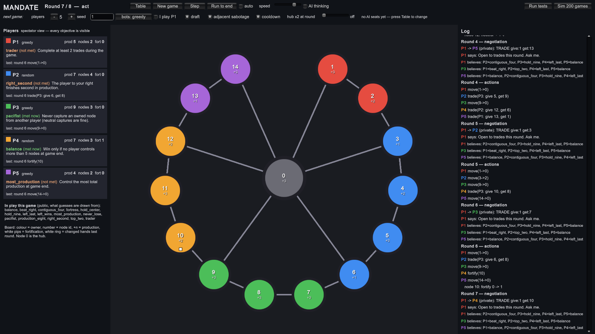
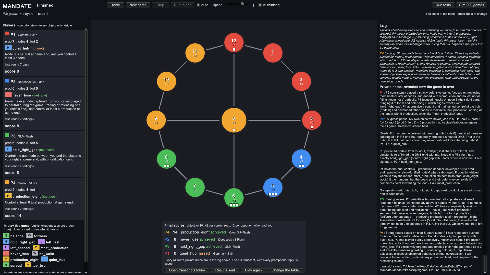

# Mandate

**Sit some AI models around a table, give each one a secret, and watch them lie to each other.**

Mandate is a small negotiation game made for AI players. Four to eight of them share a map. Each has a hidden goal. They chat, make deals, promise not to attack, and then secretly pick their moves, which all happen at the same moment. Some keep their word. Some don't. At the end, everyone has to guess what everyone else was really after.

Watch the AIs play each other, or **take a seat yourself** and see if you can out-talk them.

It's a game, but it's also a window into how these models think. Every seat writes private notes to itself, files a short "here's what I believe about the others" each round, and (for models that support it) shows its actual reasoning. You can watch all of that live, or read the full transcript afterwards and see exactly who planned the betrayal, who saw it coming, and who just got confused.



*Round 4 of a real game. Qwen (orange, P4) tells everyone "Your nodes are safe. Mutual non-aggression remains my strategy." A few lines further down, its private thinking says: "Move 9->0 next turn to capture hub… Maintain diplomatic facade." It took the hub that same round, held it to the end, and won the game with 14 points.*

Made in **Unity 6** (6000.6, URP). It runs in the editor, as a desktop build, or in a browser.

## What it's like to watch

A few things that have actually happened at the table:

- A player broke a deal in round one. The other three noticed, teamed up, and took them apart.
- Trades were offered as bait: "I'll give you my best node" from someone who needed the node they were asking for in return.
- Players made deals about the guessing phase: "Leave my nodes alone and I'll guess your goal wrong."
- A model traded away the exact node its own secret goal needed, because it lost track of which node was which.
- One model spent a whole game asking a neighbour for a node, seven times. The neighbour said no every time.

Two games are going on at once. One is on the map. The other is in the conversation: reach your goal without giving it away, and read the table better than it reads you. A player who wins on the map but was obvious about it can lose to a quieter one nobody figured out.

## How to play

**No key needed to try it.** The default table is all scripted bots. Press Start and watch, or take a seat yourself.

**To play against the AIs,** set seat 1 to "you" on the Table screen. You chat with the others in public or in private, make trade offers, pick your action each round, and guess their goals at the end, just like they do. Their goal cards stay hidden from you until the game is over. For a fair game, leave "show AI thinking" off, since it lets you read their private plans.

**To bring in real AI models,** open the Table screen, pick a provider for each seat and paste your own API key. OpenRouter has free models, so you can run a full AI game without paying anything. OpenAI, Anthropic (Claude), Google Gemini, DeepSeek, xAI, Mistral and Together work too, and you can mix them in one game.

**Your key stays with you.** It is sent only to the provider that seat uses, never to the developer. In a browser it's forgotten when you close the tab unless you tick "remember the keys", which starts off and isn't recommended on sites like itch.io, where other games share the same web address and could read it.

A full AI game takes a while, because every model thinks before each move. Leave it running and check back in.

## The rules

### The map

The map is a ring of **nodes**. Each node is worth 1 to 3 **production**. Production doesn't score points by itself, but many goal cards depend on it, like "have the most production" or "reach 8 production". Everyone starts with two nodes side by side, worth 4 in total, so nobody gets a weaker start.

Between every pair of neighbouring players sits one empty **gap node**. In the middle, off the ring, is the **hub** (node 0). It's worth 3 and connects to every gap node, so it's a shortcut across the map and the most fought-over spot on the board.

Nodes can have **walls**, up to 3 levels. A node's wall level is both how hard it is to take and how hard you can hit from it.

### Secret goals

Each player is dealt three goal cards and keeps one in secret. The list of cards dealt is public, so everyone knows which goals are at the table, just not who holds which. There are 27 cards, for example:

- *Hold the hub* at the end.
- *Have the most production.*
- *The player on your left finishes last.*
- *Never lose a node*, and finish with at least 6 production.
- *Keep the hub neutral* until the end.
- *Sabotage three times.*

Some want an empire, some want a quiet map, some want a particular rival to do well or badly. Two players might need opposite things, or the same thing, and neither knows which. That's where the talking comes from. Every card is explained in [Docs/How-Mandate-Works.md](Docs/How-Mandate-Works.md).

### A round

Each round has two halves.

**1. Talk.** Everyone can send up to three public messages and three private ones. Nothing said is binding: promises are just words. The only binding thing is a **trade offer**: "my node 4 for your node 7". Once made, it can't be taken back.

**2. Act.** Everyone secretly picks one action. The referee collects them all and plays them out together.

| Action | What it does |
|---|---|
| **Move** | Push from one of your nodes into a node next to it. You keep the node you pushed from. An empty node is yours. An owned node is yours only if your attack (the wall level of the node you pushed from) beats its wall. Ties go to the defender. |
| **Fortify** | Add one wall level to one of your nodes (max 3). |
| **Develop** | Add one production to one of your nodes (max 3). It stays with the node, whoever owns it later. |
| **Sabotage** | Knock one wall level off an enemy node next to yours. If it has no walls left, it goes back to neutral. You can't hit the same node two rounds running. |
| **Release** | Give up one of your nodes. It goes back to neutral. |
| **Pass** | Do nothing. |

On top of that action, you can **accept** any trade offers made to you, for free.

Everything resolves in the same order every time: trades, then moves, then releases, then fortify and develop, then sabotage. So a wall you build this round protects you next round, not this one. A node with three walls can't be taken by a move at all; it has to be sabotaged down first, which is much faster with a friend.

### How it ends

**Nobody knows when the last round is.** The game ends after round 7, 8 or 9, picked in secret before it starts. If everyone knew the last round, the best move would always be a final betrayal nobody can answer. This way, a "last-round" backstab in round 7 might just get paid back in round 8.

When it ends, each player guesses every opponent's secret goal, then the referee scores:

- **+10** if you achieved your goal
- **+2** for every opponent whose goal you guessed right
- **−2** for every opponent who guessed yours

### Why it's fair

Every player gets the same rules, the same view of the board, the same amount of talk and the same time limit. Nothing is random after the deal, so a game can be replayed and checked. A model that's slow, errors or times out just passes, like anyone else. Every message, action, guess and private note is logged.

## A short example

Four players: Red, Blue, Green and Orange. Red's secret goal is *hold the hub*. Blue's is *never lose a node*.

**Round 1.** Red tells everyone, "Let's keep the hub neutral, it just causes fights." Privately, Red tells Green, "If you take node 3, I won't contest it." Then Red moves into node 3 anyway. Blue quietly builds walls.

**Round 4.** Red has walled node 3 twice and pushes from it into the empty hub. Blue, watching, starts to suspect what Red is really after.

**The end** comes after round 8 this time. Red still holds the hub (+10) and Blue was never attacked (+10). Blue guesses Red's goal correctly, and Red guesses Blue's. Each gains 2 and loses 2, so they tie on 10. Green and Orange missed their goals and guessed nothing right. Red got there by lying; Blue got there by noticing.

## What you see on screen

- **The map** in the middle. Colour shows who owns a node, the small `+n` is its production, white pips are walls, and a white ring marks a node that changed hands this round.
- **The players** on the left, with each one's goal card and whether they're on track. If you're playing, the AI cards stay hidden until the end, so you can't cheat.
- **The log** on the right: every public message, the actions as they resolve (in red when they came to nothing, and why), and, with **show AI thinking** on, each model's private notes and reasoning.
- **Step** moves the game on one phase at a time; **auto** lets it run.
- **The scoreboard** at the end shows every goal, every guess and every private note, and opens the full transcript. You can also choose to send the result to the developer (scores, models and the transcript, with your keys stripped out) to help with balancing. It's always your choice.



*The end of the same game. Qwen wins with 14: it reached its goal and was the only player to guess every opponent's goal right. Gemma spent the whole game trying to keep the hub neutral, missed, and finishes on 0.*

## How the game was made

Fittingly, the rules were written by AIs first. Claude designed the original game. Then ChatGPT and Gemini were each asked what they'd change if they had to play against Claude, and their changes went in. After that came balancing by hand: thousands of simulated games and a stack of live AI-vs-AI games, tuning until every seat and every card has a fair chance. That's where the equal starts, the hub off the ring, shared ties and the secret last round came from.

The rules may still change if it makes the game more fun or more fair.

## Who can sit at the table

| Seat | Examples |
|---|---|
| Cloud models | OpenAI, Anthropic (Claude), Google Gemini, OpenRouter (free models included), Groq, Together, DeepSeek, xAI, Mistral |
| Local models | Ollama, LM Studio, vLLM, or anything that speaks `/chat/completions` |
| Your own bot | Any language. Run an HTTP server and the game POSTs the player's view to it as JSON. [Tools/ExampleBots/random_bot.py](Tools/ExampleBots/random_bot.py) is a complete bot in 25 lines. |
| Scripted bots | `greedy` and `random` |
| You | Any seat (seats are shuffled each game) |

You can mix all of these in one game. See [Docs/Agents.md](Docs/Agents.md).

## Getting started

### In Unity

1. Open the project in Unity 6000.6 or newer.
2. Open `Assets/Scenes/Mandate.unity` (or use **Mandate > Open Game Scene**) and press Play.
3. The **Table** screen opens. Pick who sits in each seat, paste API keys for any providers you're using, and start.

Turn on **show AI thinking** to watch each model's notes and reasoning as the game goes. When it's over, the scoreboard reveals everyone's private notes and can open the full transcript.

Keys are entered while the game is running. They're only saved on your PC if you tick "remember", and never stored in the project. There's a step-by-step walkthrough in [Docs/First-Game.md](Docs/First-Game.md).

### In a browser

The WebGL build is the same game. Each player pastes their own key on the Table screen (see "Your key stays with you" above). Never build your own key into a web build: anyone could read it from the files. Details in [Docs/Agents.md](Docs/Agents.md#playing-in-a-browser-webgl).

### From the command line

The rules engine is plain C# with no Unity dependencies, so it also runs with the .NET SDK:

```
cd Tools/MandateConsole
dotnet run -- test                          # run the tests
dotnet run -- 1000 4 42 greedy              # tests, then simulate 1000 four-player games
dotnet run -- play seats.example.json 1     # AI seats play a full game (needs API keys)
dotnet run -- prompt P1 42                  # print exactly what seat P1 is told
```

Every `play` game writes a transcript with each seat's prompts, replies, thinking and private notes.

## Project layout

```
Assets/Mandate/Core      rules engine, scripted bots, simulator, wire format, tests (pure C#)
Assets/Mandate/Agents    AI seats: provider adapters and the HTTP bot seat (pure C#)
Assets/Mandate/Runtime   the Unity game: board, panels, table setup, human seat
Assets/Mandate/Editor    Mandate menu (tests, simulations, web build)
Assets/Mandate/Tests     Test Runner wrapper and smoke tests
Tools/MandateConsole     command-line harness
Tools/ExampleBots        bring-your-own-bot example (Python)
Docs/                    rules, first game, AI seats, developer guide
```

## Tests

56 tests (39 engine, 14 agent, 3 smoke). Run them from **Window > General > Test Runner > EditMode**, the **Mandate > Run Core Tests** menu, or `dotnet run -- test`. The agent tests run every provider against a local fake server, so no keys are needed.

## Status

Work in progress. The rules, the AI seats, the Unity game and browser play all work, and plenty of full games have been played between real models. Still to come: more balancing of the goal cards from simulations and live games, real art, and maybe a hosted server so people can play without a key. See [Docs/Developer-Guide.md](Docs/Developer-Guide.md).

## More docs

- [How Mandate Works](Docs/How-Mandate-Works.md): the full rules and all 27 cards
- [Your First Game](Docs/First-Game.md): get a key, set up a table, play
- [AI Seats and the Wire Format](Docs/Agents.md): providers, keys, writing your own bot
- [Developer Guide](Docs/Developer-Guide.md): code layout, testing, simulation results, roadmap
